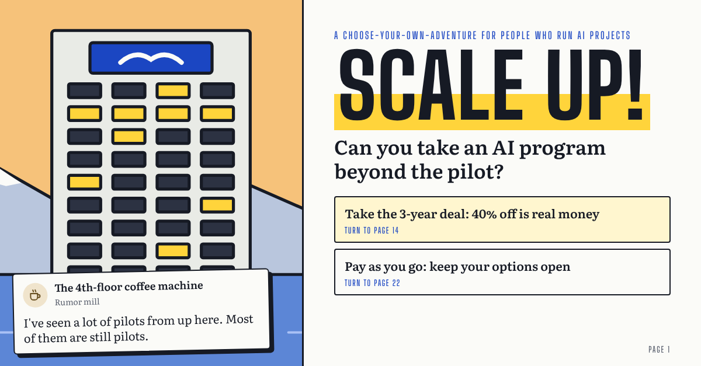

# Scale Up!

**Can you take an AI program beyond the pilot?**

**[Play it here: inhabitedisland.github.io/scale-up](https://inhabitedisland.github.io/scale-up/)**

Most AI projects never leave the pilot. The ones that do mostly fail during the rollout. Scale Up! is a choose-your-own-adventure about why.

You are the new program lead of Project MOMENTUM, an AI assistant that listens to insurance claims calls and drafts the claim file. Over one year you take it from kick-off to pilot, through the scale decision and the rollout, to annual planning. Along the way you deal with vendors, data owners, a regulator-shaped notebook and a coffee machine that hears everything first.

The first time you play, you see one number: the payback on the business case. Everything else that decides how it ends is tracked in secret and revealed on the final page, including what happens to your career. Finish once to unlock the full program manager dashboard.

It runs in any browser, on a phone or a laptop. No sign-up, no download.

## About

Scale Up! is a simulation built from the experience of several real AI programs. Albatross Insurance, its people and every number are invented. The rules it plays with, from the EU AI Act to audit, are simplified, so read them as prompts for a conversation, not as advice.

Made by [Nikita Pavlov](https://www.linkedin.com/in/nikita-s-pavlov/).
